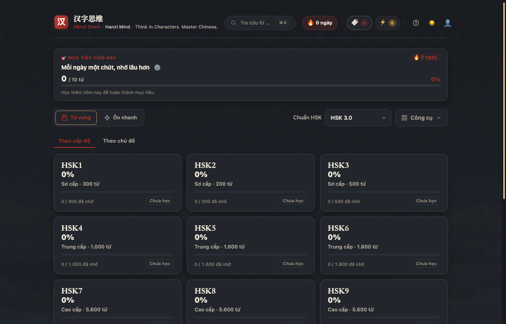
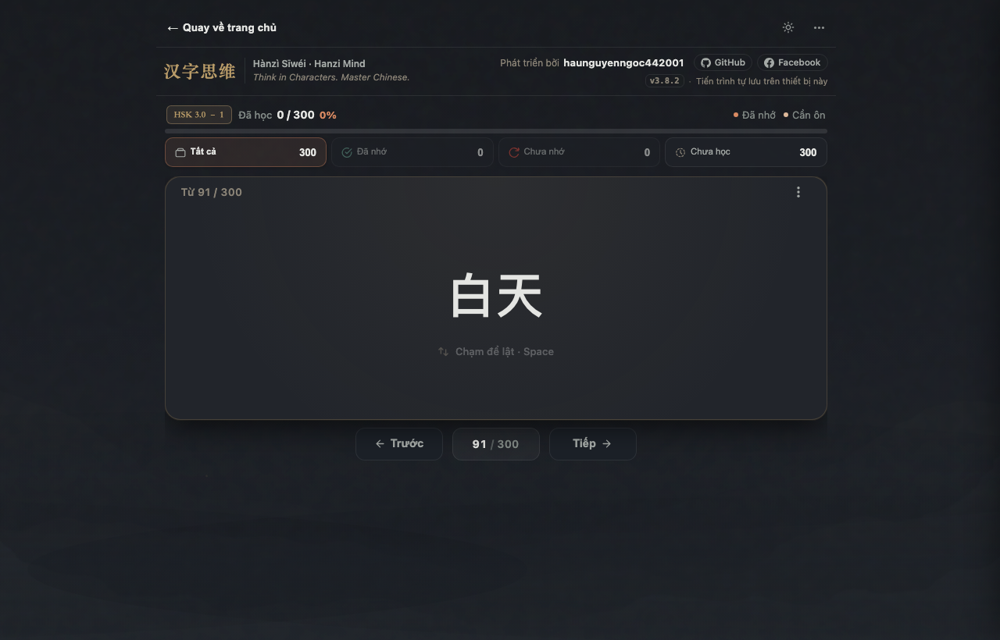
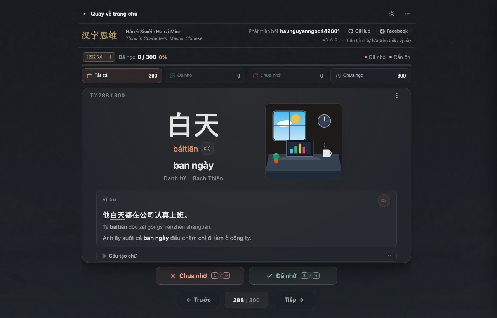
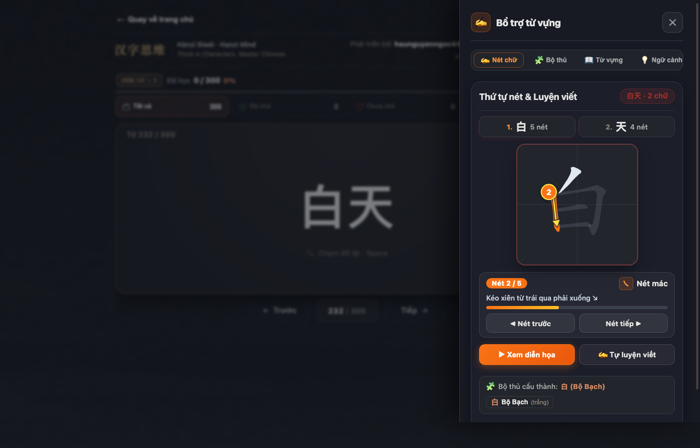
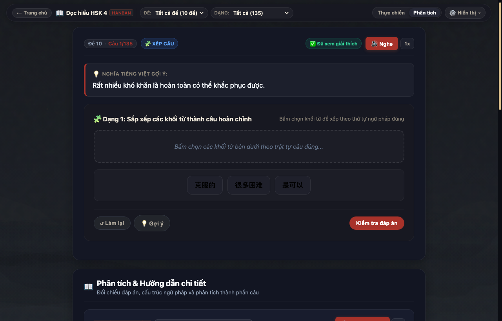
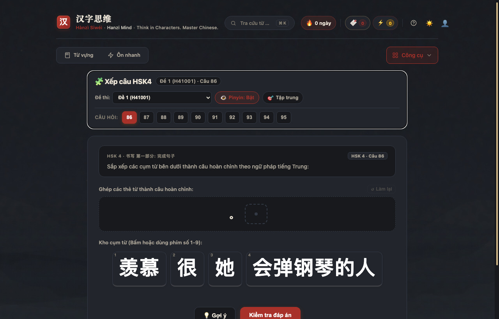
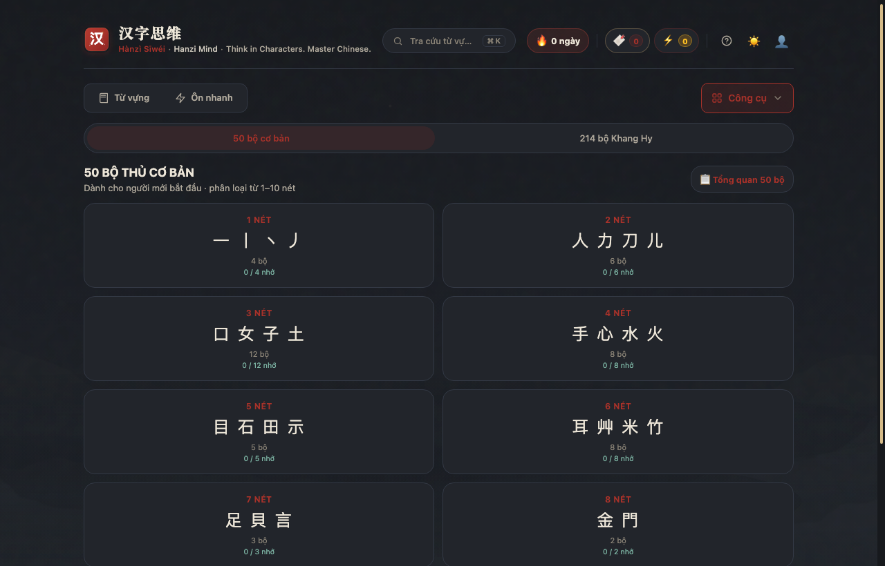

# ⚡ 汉字思维 (Hànzì Sīwéi) — Hanzi Mind

> **Think in Characters. Master Chinese.**  
> Trạm học từ vựng chữ Hán qua tư duy bản chất, liên kết ngữ cảnh, đa giác quan và 100% Offline (PWA).  
> Kết hợp phương pháp lặp lại ngắt quãng **Spaced Repetition (FSRS)**, minh họa ngữ cảnh sinh động (Visual Mnemonics), phân tích đọc hiểu chuyên sâu **HSK 4 Chuẩn Hanban**, luyện nghe đề thi thực tế, mô phỏng viết nét bút thuận và tra cứu âm Hán - Việt.

---

### 🌐 Trải nghiệm trực tuyến ngay (Live Demo):
👉 **Website chính thức:** [**https://nguyenhau442001.github.io/Synapse-Hanzi/**](https://nguyenhau442001.github.io/Synapse-Hanzi/)

*(Không cần cài đặt, hoạt động mượt mà và tối ưu trên cả máy tính lẫn điện thoại)*

<p align="center">
  <a href="https://nguyenhau442001.github.io/Synapse-Hanzi/">
    
  </a>
  
  
  
  
  
</p>

---

## 📸 Giao diện ứng dụng (Visual Tour)

### 1. 🎯 Bảng điều khiển học tập (Dashboard)
Theo dõi mục tiêu học tập hàng ngày, chuỗi ngày học (Streak 🔥), từ vựng của ngày và biểu đồ đóng góp (Heatmap).

<p align="center">
  
</p>

---

### 2. 🎴 Thẻ Flashcard chia đôi & Tranh minh họa ngữ cảnh lớn (Split-Card Visual Mnemonic)
Thiết kế mỹ học thủy mặc Đông phương hiện đại kết hợp bố cục chia đôi (Split Layout) tối ưu cho việc ghi nhớ đa giác quan:
- 🖼️ **Tranh minh họa ngữ cảnh kích thước lớn:** Mô tả trực quan hành động thực tế dựa theo câu ví dụ, kích hoạt trí nhớ hình ảnh bản chất.
- 📝 **Thông tin từ vựng tinh gọn:** Chữ Hán tiêu điểm, Pinyin chuẩn, âm Hán - Việt, chiết tự chữ, chữ liên quan và câu ví dụ song ngữ.
- ⚡ **Thao tác lật thẻ và chấm điểm siêu nhanh:**
  - ❌ **Chưa nhớ [Phím 1 / ← / Vuốt trái]**: Đưa từ vào danh sách ôn tập ngay trong ngày.
  - ✅ **Đã nhớ [Phím 2 / → / Vuốt phải]**: Tự động tính toán chu kỳ lặp lại ngắt quãng FSRS.

<p align="center">
  
  
</p>

---

### 3. ✍️ Luyện viết chữ Hán tương tác (Hanzi Writer)
Bảng phụ trợ (Slide-over Drawer) mô phỏng từng nét viết bút thuận bằng animation và bảng vẽ Canvas tự luyện viết trực tiếp bằng chuột hoặc cảm ứng.

<p align="center">
  
</p>

---

### 4. 📖 Đọc hiểu & Phân tích ngữ pháp HSK 4 (Chuẩn Hanban)
Phân tích cấu trúc câu chuyên sâu (Chủ ngữ - Vị ngữ - Tân ngữ, liên từ), bẫy thi thường gặp, từ loại, phiên âm và âm Hán - Việt theo ngữ cảnh. Hỗ trợ **Zen Mode** tập trung cao độ.

<p align="center">
  
</p>

---

### 5. 🧩 Phòng thực hành & Trò chơi củng cố phản xạ
Rèn luyện cấu trúc ngữ pháp qua game **Sắp xếp từ thành câu (Sentence Game)**, Đoán từ (Guess Word) và Speed Quiz.

<p align="center">
  
</p>

---

### 6. 🀄 Trọn bộ 50 & 214 Bộ thủ Khang Hy
Tra cứu và học bộ thủ theo số nét, ý nghĩa, ví dụ và thống kê tiến độ riêng biệt.

<p align="center">
  
</p>

---

## ⚡ Điểm nổi bật & Tính năng cốt lõi

- **Kho từ vựng khổng lồ:**
  - **HSK 2.0:** Đầy đủ 5.000 từ vựng cốt lõi HSK 1 đến HSK 6.
  - **HSK 3.0 mới:** Hơn 11.000 từ vựng theo khung khảo thí quốc tế (Cấp 1–9).
  - **Bộ thủ:** 50 bộ thủ cơ bản & 214 bộ thủ Khang Hy.
  - **Từ vựng theo chủ đề:** Công nghệ thông tin (IT), Du lịch, Kinh doanh...
- **Spaced Repetition tối ưu:** Thuật toán FSRS v5 tự động tính toán thời điểm ôn tập khoa học, dự đoán tỷ lệ nhớ theo đường cong Ebbinghaus.
- **Tự động gắn âm Hán - Việt:** Giúp người Việt hiểu nghĩa gốc sâu sắc và ghi nhớ từ vựng nhanh gấp đôi.
- **Âm thanh giọng thật chuẩn phòng thu & Web Speech API:** Tích hợp bộ audio MP3 24kHz tự nhiên cho toàn bộ từ vựng và câu ví dụ (HSK 2.0 Level 1–4 và HSK 3.0 Level 1), tự động fallback Web Speech API thông minh trên mọi trình duyệt.
- **SPA Router thông minh:** Hỗ trợ nút Back/Forward vật lý của trình duyệt và chia sẻ liên kết trực tiếp (Deep Linking) mà không tải lại trang.
- **Bộ công cụ bổ trợ ôn thi HSK toàn diện:**
  - **Luyện đề Nghe HSK 4 thực chiến:** Tích hợp audio chuẩn bài thi, script đối thoại và giải thích đáp án.
  - **Phân tích ngữ pháp & Đọc hiểu (Reading Analysis):** Đọc truyện phân cấp HSK 1–9, giải mã từng cấu trúc ngữ pháp khó.
  - **Luyện viết nét bút thuận:** Mô phỏng quy tắc viết chữ Hán và bảng vẽ tương tác.
- **Tiến trình tự động lưu:** Toàn bộ lịch sử học tập và tiến trình SRS được đồng bộ an toàn ngay trên trình duyệt máy bạn.

---

## ⌨️ Phím tắt bàn phím (Desktop Shortcuts)

| Phím tắt | Thao tác nhanh |
| :---: | :--- |
| `Space` / `Enter` | **Lật thẻ** (Xem mặt sau / Ẩn mặt sau) |
| `1` hoặc `←` | Đánh dấu **❌ Chưa nhớ** (Ôn lại hôm nay) |
| `2` hoặc `→` | Đánh dấu **✅ Đã nhớ** (Tăng chu kỳ SRS) |
| `A` | **Nghe phát âm** chữ Hán (Web Speech API) |
| `R` | Ngẫu nhiên nhảy đến một từ bất kỳ |
| `H` | Bật / Tắt hiển thị **âm Hán - Việt** |
| `W` | Mở / Đóng bảng **Luyện viết chữ Hán** & Bút thuận |
| `B` | Mở / Đóng ngăn kéo **Danh sách từ vựng** trong bài |

---

## 🏛️ Kiến trúc ứng dụng (Application Architecture)

Từ phiên bản **v3.2.0**, dự án áp dụng mô hình kiến trúc **Component-driven Decoupled Architecture** trên nền tảng **Preact + Signals + Vite**. Mô hình này giải quyết triệt để vấn đề hiệu ứng domino (sửa một tính năng kéo theo sửa hàng loạt file) bằng cách chia nhỏ toàn bộ ứng dụng thành các khối độc lập, có ranh giới trách nhiệm rõ ràng (Single Responsibility Principle) và dễ tháo rời:

```
src/
├── main.jsx                     # Khởi tạo Reactivity & Mount ứng dụng
├── App.jsx                      # Bộ điều hướng trung tâm (Declarative Router, <80 lines)
│
├── components/                  # Các UI Component nguyên tử, độc lập, tái sử dụng
│   ├── AppHeader.jsx            # Brand header, switch theme sáng/tối, tabs & SRS due badge
│   ├── Flashcard.jsx            # Sân khấu thẻ học chữ Hán (Front, Back, Pinyin, Strokes)
│   ├── LevelPicker.jsx          # Thanh trượt chọn nhanh cấp độ HSK 1 đến HSK 9
│   ├── PlumBlossomBackground.jsx# Hiệu ứng cánh hoa mai bay thư pháp tự quản lý trên Canvas
│   ├── ProgressNav.jsx          # Thanh tiến trình & 4 khối phân loại trạng thái từ vựng
│   ├── RatingActions.jsx        # Nút chấm điểm linh hoạt (Tự đổi ← / → trên mobile, phím 1/2 trên desktop)
│   └── StudyNavigation.jsx      # Cụm nút điều hướng trước/sau thẻ, đếm tiến độ, shuffle
│
├── views/                       # Các màn hình chế độ học tập độc lập (View Containers)
│   ├── StudyView.jsx            # Màn hình học thẻ Flashcard chính
│   ├── DueReviewView.jsx        # Chế độ thiền định Zen ôn tập từ đến hạn (FSRS)
│   ├── ListeningView.jsx        # Phòng luyện nghe đề thi HSK 4 kèm audio & transcript đồng bộ
│   ├── ReadingView.jsx          # Chế độ đọc truyện & phân tích ngữ pháp Hanban
│   ├── RadicalsView.jsx         # Tra cứu & thực hành 50 - 214 Bộ thủ Khang Hy
│   └── GamesView.jsx            # Mini-game phản xạ (Sentence Game, Speed Quiz, Đoán từ)
│
├── signals/                     # Quản lý State phân tán & Reactive (Zero re-render bloat)
│   ├── studySignals.js          # State danh sách từ, bộ lọc, tiến độ học hiện tại
│   ├── srsSignals.js            # State hàng đợi ôn tập FSRS hôm nay
│   └── fastReviewSignals.js     # State phiên kiểm tra nhanh (Lives, Timer, Score)
│
├── services/                    # Tầng nghiệp vụ xử lý logic độc lập (Pure Logic)
│   ├── speechService.js         # Tổng hợp giọng đọc TTS (Web Speech API) & Speech Queue
│   ├── fsrsService.js           # Thuật toán tính chu kỳ lặp lại ngắt quãng (FSRS v5)
│   └── dbService.js             # Kết nối & truy vấn IndexedDB / LocalStorage
│
└── styles/                      # Hệ thống Design Tokens & CSS Modules
    └── main.css                 # Bảng biến màu (CSS Variables), Reset & Typography
```

### 💡 Ưu điểm của mô hình Module hóa cục bộ:
1. **Cô lập lỗi (Fault Isolation):** Cần chỉnh sửa giao diện nút bấm hoặc logic của một màn hình chỉ cần mở đúng 1 file component/view tương ứng, không làm ảnh hưởng đến các màn hình khác.
2. **Reactivity với Preact Signals:** State được cập nhật trực tiếp tại DOM node cần thay đổi thay vì kích hoạt re-render toàn bộ cây component, mang lại hiệu năng 60 FPS mượt mà ngay cả trên thiết bị di động cấu hình thấp.
3. **Đóng gói siêu nhẹ:** Vite build toàn bộ ứng dụng (Preact, FSRS, Hanzi Writer, 6 Views) chỉ mất **~50ms**, dung lượng bundle gzipped chỉ **~43 kB**.

---

## 💻 Hướng dẫn chạy cục bộ (Local Development)

### Cách 1: Sử dụng Vite Dev Server (Khuyên dùng cho phát triển)
```bash
# 1. Cài đặt dependencies
npm install

# 2. Khởi chạy Vite Dev Server (mở port 3000)
npm run dev

# 3. Đóng gói sản phẩm (Production Build)
npm run build
```

### Cách 2: Khởi chạy nhanh không cần Node.js
```bash
# Khởi chạy HTTP server bằng Python 3
python3 -m http.server 8000
```
Mở trình duyệt truy cập: **`http://localhost:8000/`** (hoặc `http://localhost:3000/` khi dùng Vite).

### Preact islands trong `index.html`
`index.html` (bản đang chạy thật) được chuyển dần sang Preact theo từng phần: mỗi "island" trong `src/islands/` render **đúng markup và class CSS cũ** nên giao diện không đổi. Bundle được commit sẵn để host tĩnh không cần build:
```bash
npm run build:islands   # build src/islands -> assets/js/preact/islands.js (commit file này)
```
Đã chuyển: modal Hướng dẫn & Trợ giúp (`StudyHelpModal.jsx`), game Đuổi hình bắt chữ (`GuessWordGame.jsx`), game Điền từ vào câu (`SpeedQuizGame.jsx`), game Xếp câu HSK4 (`SentenceGame.jsx`), Tổng quan từ vựng (`VocabularyOverview.jsx`).

---

## 🔒 Lưu trữ & Bản sao tiến trình

- Dữ liệu học tập được tự động lưu trong `localStorage` của trình duyệt.
- Dễ dàng chuyển đổi giữa các thiết bị tại mục **Sao lưu và chuyển thiết bị**:
  - **💾 Tải bản sao tiến trình:** Tải file `.json` nhẹ ~15KB.
  - **📂 Khôi phục từ bản sao:** Chọn file `.json` để tiếp tục phiên học trên máy mới.

---

## 👨‍💻 Tác giả & Giấy phép

- **Tác giả:** [Nguyễn Ngọc Hậu (haunguyenngoc442001)](https://github.com/nguyenhau442001)
- **Giấy phép:** Open Source - [MIT License](LICENSE).
